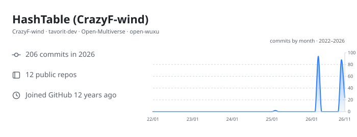
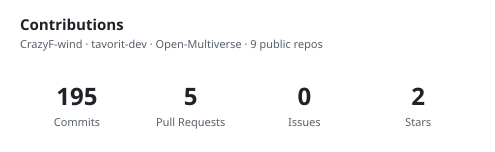
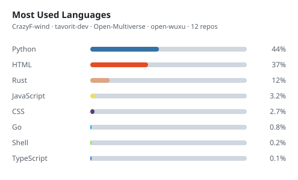

  <b>English</b> | <a href="README.zh-CN.md">简体中文</a>

<h1 align="center">Hi 👋, I'm HashTable</h1>

  

  
  
  

---

## 🧑‍💻 About Me

- 🌱 Currently exploring **AI Agents**
- 💻 I believe that **technology and innovation can change the world.**
- 📝 I write now and then — everything lives on my [blog](https://crazyf-wind.github.io/)
- ⚡ In my spare time I read source code, build tools, and make simple things complicated only to boil them back down to simple

## 🛠 Tech Stack

  
  
  
  
  
  
  

  
  
  
  

## 📊 GitHub Stats

  

  
  

  

## 🚀 Projects

### 🤖 Agent Applications — [tavorit-dev](https://github.com/tavorit-dev)

| Project | Description | Tech |
| --- | --- | --- |
| [weather-advisor-skill](https://github.com/tavorit-dev/weather-advisor-skill) | Guanxiang (观象) — reads the weather evidence first, then turns it into actions you can take today; entry Skill + JSON Schema + 6 examples + 32 acceptance cases | Markdown / JSON Schema / Python |
| [Gewu-skill](https://github.com/tavorit-dev/Gewu-skill) | Gewu (格物) — a technical-knowledge visual explanation engine: finds what is worth visualizing, extracts a verifiable explanation model (VEM), then renders and validates accurate SVG diagrams | Python / SVG |
| [ResearchScout-Skill](https://github.com/tavorit-dev/ResearchScout-Skill) | Wanxiang (万象) — turns a research objective into a resumable, traceable local knowledge base: discovery, compliant collection, evidence extraction, Markdown / CSV / static HTML export | Python / Markdown |
| [WriterSkill](https://github.com/tavorit-dev/WriterSkill) | Tiangong (天工) — a general writing Skill in design: understand the intent, plan the content, then shape structure and expression | Markdown |

### 🎮 Visual Engine & Games — [Open-Multiverse](https://github.com/Open-Multiverse)

| Project | Description | Tech |
| --- | --- | --- |
| [NovaEngine](https://github.com/Open-Multiverse/NovaEngine) | A Web 3D game engine built with Rust and WebAssembly — WebGPU rendering, Rapier3D physics, egui UI | Rust / WebAssembly |

### 🏭 Industrial Visualization — [open-wuxu](https://github.com/open-wuxu)

| Project | Description | Tech |
| --- | --- | --- |
| [AssetStudio](https://github.com/open-wuxu/AssetStudio) | WUXU (物序) — an open-source industrial asset visualization and monitoring platform: asset registry, device topology, live sensor data and dashboards | Go / React / TypeScript |

### 🧩 Personal

| Project | Description | Tech |
| --- | --- | --- |
| [HashTableLabs](https://github.com/CrazyF-wind/HashTableLabs) | Runnable companion code for my blog — six self-contained examples across backend, frontend and DevOps, each linked to its article | Go / Node.js |
| [crazyf-wind.github.io](https://github.com/CrazyF-wind/crazyf-wind.github.io) | Source of my personal tech blog — a static site published with GitHub Pages | HTML / CSS / JS |

## 📫 Find Me

  
  
  
  
  

---

<i>Eat, Sleep, Code, Repeat.</i>

<!-- Keep this file in sync with README.zh-CN.md -->
