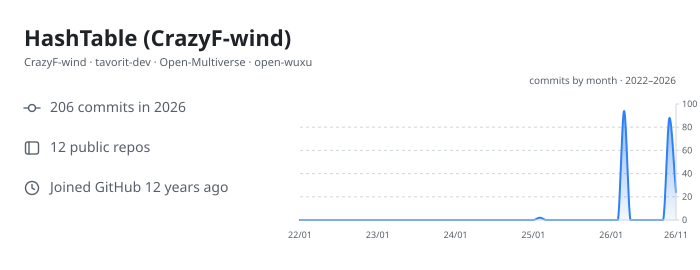
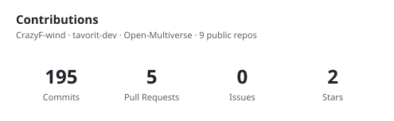
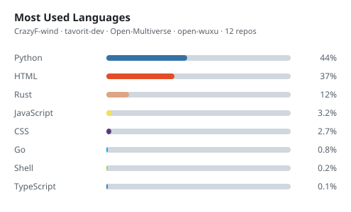

  <a href="README.md">English</a> | <b>简体中文</b>

<h1 align="center">Hi 👋, I'm HashTable</h1>

  

  
  
  

---

## 🧑‍💻 关于我

- 🌱 正在折腾 **AI Agent**
- 💻 相信「**技术、创新可以改变世界.**」
- 📝 偶尔写点东西，都在我的 [博客](https://crazyf-wind.github.io/) 里
- ⚡ 空闲时间喜欢读源码、造轮子、把简单的事情做复杂再简化回来

## 🛠 技术栈

  
  
  
  
  
  
  

  
  
  
  

## 📊 GitHub 统计

  

  
  

  

## 🚀 项目

### 🤖 Agent 应用 —— [tavorit-dev](https://github.com/tavorit-dev)

| 项目 | 简介 | 技术 |
| --- | --- | --- |
| [weather-advisor-skill](https://github.com/tavorit-dev/weather-advisor-skill) | 观象：先看天气证据，再把它变成今天就能执行的动作 —— 入口 Skill + JSON Schema + 6 组示例 + 32 条验收用例 | Markdown / JSON Schema / Python |
| [Gewu-skill](https://github.com/tavorit-dev/Gewu-skill) | 格物：技术知识视觉解释引擎 —— 先发现真正值得画的原理，提取可验证的解释模型（VEM），再渲染并校验准确的 SVG 原理图 | Python / SVG |
| [ResearchScout-Skill](https://github.com/tavorit-dev/ResearchScout-Skill) | 万象：把研究主题变成可断点续跑、可追溯的本地知识库 —— 来源发现、合规采集、证据抽取，导出 Markdown / CSV / 静态 HTML | Python / Markdown |
| [WriterSkill](https://github.com/tavorit-dev/WriterSkill) | 天工：正在设计中的通用写作 Skill —— 理解创作意图，辅助内容规划、结构优化与表达打磨 | Markdown |

### 🎮 视觉引擎 & 游戏 —— [Open-Multiverse](https://github.com/Open-Multiverse)

| 项目 | 简介 | 技术 |
| --- | --- | --- |
| [NovaEngine](https://github.com/Open-Multiverse/NovaEngine) | 用 Rust + WebAssembly 构建的 Web 3D 游戏引擎 —— WebGPU 渲染、Rapier3D 物理、egui 界面 | Rust / WebAssembly |

### 🏭 工业可视化 —— [open-wuxu](https://github.com/open-wuxu)

| 项目 | 简介 | 技术 |
| --- | --- | --- |
| [AssetStudio](https://github.com/open-wuxu/AssetStudio) | 物序 WUXU 旗下的开源工业资产可视化与监控平台 —— 资产台账、设备拓扑、实时数据与可视化看板 | Go / React / TypeScript |

### 🧩 个人项目

| 项目 | 简介 | 技术 |
| --- | --- | --- |
| [HashTableLabs](https://github.com/CrazyF-wind/HashTableLabs) | 博客文章的「可运行版本」—— 后端、前端、DevOps 六个自包含示例，每个都对应一篇文章 | Go / Node.js |
| [crazyf-wind.github.io](https://github.com/CrazyF-wind/crazyf-wind.github.io) | 个人技术博客源码，通过 GitHub Pages 发布的静态站点 | HTML / CSS / JS |

## 📫 找到我

  
  
  
  
  

---

<i>Eat, Sleep, Code, Repeat.</i>

<!-- Keep this file in sync with README.md -->
